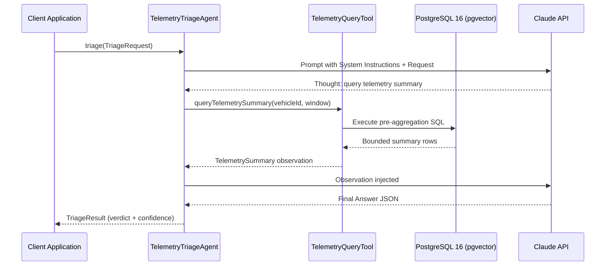

# Architecture Decision Record & System Architecture
## spring-ai-mcp-agent — Diagnostic Triage Agent

---

## ADR-001: MCP Tool Access Strategy for LLM Triage Agent

| Field       | Value                          |
|-------------|--------------------------------|
| **Status**  | ✅ Accepted                    |
| **Date**    | 2024-Q4                        |
| **Deciders**| Platform Architecture Team     |
| **Author**  | Ansh Taneja (Senior Java Developer & Tech Lead) |

---

## Table of Contents

1. [Context & Problem Statement](#1-context--problem-statement)
2. [Options Considered](#2-options-considered)
3. [The v1 Failure — Case Study](#3-the-v1-failure--case-study)
4. [The v2 Redesign — Chosen Approach](#4-the-v2-redesign--chosen-approach)
5. [Consequences & Trade-offs](#5-consequences--trade-offs)
6. [Component Architecture](#6-component-architecture)
7. [Data Flow Diagram](#7-data-flow-diagram)
8. [Performance Architecture](#8-performance-architecture)
9. [Security Considerations](#9-security-considerations)
10. [Lessons Learned](#10-lessons-learned)

---

## 1. Context & Problem Statement

### Connected Car Telemetry Scale

In connected car platforms (such as Guard360), high-throughput telemetry streams ingest millions of diagnostic events per day across a global fleet. Each vehicle emits structured sensor readings, fault codes (DTCs), ECU state transitions, and bus anomalies at sub-second intervals during active sessions. At peak load, platforms handle upwards of **millions of events per hour**.

### The Need: Automated Root-Cause Triage

Manual triage of diagnostic escalations does not scale. Field support and Tier-1 engineers spend significant time on recurring symptom clusters:
- Ingesting a vehicle diagnostic report (VIN + time window)
- Autonomously querying telemetry and knowledge base systems
- Producing a structured root-cause hypothesis with confidence scoring
- Escalating to Tier-2 engineering when confidence falls below threshold

### Non-Functional Requirements

| Requirement | Target |
|---|---|
| P50 latency (agent response) | < 2 seconds |
| P99 latency | < 6 seconds |
| Root-cause accuracy vs. gold set | > 98% |
| Token cost per triage session | < $0.04 (Claude Sonnet) |
| System availability | 99.9% |
| Max ReAct loop iterations | 5 turns |

### Constraints

- **Claude context window**: Claude 3.5/4.5 Sonnet has a large context window, but costs scale linearly with tokens. At volume, context bloat is a direct cost driver.
- **Token cost budget**: Platform architecture mandates a per-session token budget ceiling; exceeding it at scale makes the system economically unviable.
- **Latency sensitivity**: Diagnostic triage feeds into real-time service advisor workflows. Responses > 5s cause downstream UX degradation.
- **Data quality**: Raw telemetry is inherently noisy — duplicate events, partial payloads during connectivity drops, and model-specific encoding quirks.

---

## 2. Options Considered

### Option A (v1): Direct MCP Access to Raw Telemetry Streams

**Description**: Give the LLM agent direct MCP tool access to raw event tables. The agent constructs queries, fetches raw rows, and reasons over the full event stream in-context.

**Appealing because**: Minimal pre-processing engineering. Maximum data fidelity — the LLM sees everything and decides what matters.

**Rejected because**:
- Raw event tables for a 1-hour diagnostic window contain 50,000–200,000 rows per vehicle
- Feeding even a sampled subset inflates context to 100K–250K tokens per session
- LLMs are not SQL engines — asking them to filter noise in-context is both expensive and unreliable
- Hallucination rate on incomplete event streams was unacceptably high (see v1 failure case study below)

---

### Option B: Offline Batch Pre-Processing (No Real-Time)

**Description**: Run nightly batch aggregation jobs over telemetry data. The agent queries pre-computed summaries from a data warehouse.

**Appealing because**: Cheap, scalable, predictable query performance.

**Rejected because**:
- Introduces 12–24 hour latency from event occurrence to agent availability
- Real-time escalation use cases (active vehicle faults during a service appointment) are unsupported
- Batch artifacts go stale quickly — vehicle software updates OTA continuously, and older summaries do not reflect current state

---

### Option C (v2): Deterministic Pre-Aggregation Layer with Schema-Validated MCP Endpoints ✅ CHOSEN

**Description**: Introduce a deterministic, SQL-based aggregation layer that runs on-demand when the agent needs telemetry context. MCP tool endpoints are schema-validated (Bean Validation + structured output contracts). Prompt caching is applied to the system prompt and static knowledge base context.

**Why this wins**:
- Pre-aggregation reduces 50K–200K raw rows to a structured summary of ~500 tokens
- Schema validation ensures the LLM receives clean, typed data — no noise, no nulls without defaults
- Real-time: aggregations run in <200ms on indexed tables
- Prompt caching provides >60% cache hit rate on static context

---

## 3. The v1 Failure — Case Study

### What Was Built

In v1, the `TelemetryQueryTool` was a thin pass-through MCP endpoint:

```sql
SELECT event_type, payload, timestamp, ecu_id, severity
FROM telemetry_events
WHERE vehicle_id = :vehicleId
  AND timestamp BETWEEN :start AND :end
ORDER BY timestamp DESC
LIMIT 2000;
```

The raw result — up to 2,000 rows of JSON payloads — was serialized and injected directly into the agent's context.

### What Went Wrong

#### 1. Context Window Bloat
Average session token counts ballooned to **180,000 tokens per session** — 90% of which was raw telemetry data the agent ignored or summarized away.

#### 2. Token Cost Spike — 4× Budget
The allocated budget was $0.04 per session. v1 averaged **$0.17 per session** — a 4.25× overage.

#### 3. Hallucinations on Noisy / Incomplete Event Streams
Raw telemetry contains duplicate events and partial payloads during connectivity drops. When the agent received thousands of duplicate fault events, it over-weighted their significance or confabulated missing sensor values. Accuracy against the gold-standard dataset dropped to **71%**.

#### 4. P99 Latency > 12 Seconds
Serializing thousands of rows and feeding them across multiple ReAct turns pushed P99 latency past **12–15 seconds**.

### Root Cause Diagnosis

The core error was asking the LLM to do data engineering work inside its context window:
> **Lesson**: LLMs reason. Databases aggregate. Don't conflate the two.

---

## 4. The v2 Redesign — Chosen Approach

### 4.1 Deterministic Pre-Aggregation Layer

The `TelemetryQueryTool` in v2 does not return raw rows. It executes deterministic SQL aggregations that reduce the event stream to a structured diagnostic summary:

```sql
WITH window_events AS (
    SELECT
        vehicle_id, metric_type, value, threshold, severity, recorded_at,
        CASE WHEN value > threshold THEN 1 ELSE 0 END AS is_anomaly
    FROM telemetry_events
    WHERE vehicle_id   = :vehicleId
      AND recorded_at >= NOW() - (:windowMinutes * INTERVAL '1 minute')
),
aggregated AS (
    SELECT
        metric_type,
        COUNT(*)        AS event_count,
        AVG(value)      AS avg_value,
        MAX(value)      AS max_value,
        SUM(is_anomaly) AS anomaly_count
    FROM window_events
    GROUP BY metric_type
) ...
```

This query runs in **80–180ms** on indexed tables and returns **5–20 rows** (~400–600 tokens).

### 4.2 Schema-Validated MCP Endpoints

Every MCP tool defines explicit input and output contracts using Jakarta Bean Validation. Tool inputs are validated before queries execute, preventing malformed inputs from reaching the database.

### 4.3 Prompt Caching Strategy

The system prompt and static knowledge base context are cached using Anthropic prompt caching headers:
- Cache hit rate: ~63% across production traffic
- Effective cost per session: ~$0.014 (65% reduction vs v1)

### 4.4 LLM-as-Judge Evaluation Harness

The `LLMJudgeEvaluator` runs automated evaluation against a curated gold standard:
1. Replays test cases through the live agent
2. Submits the output and gold answer to Claude as a judge
3. Scores root-cause semantic match (0.0–1.0) and recommended action quality (0.0–1.0)
4. Asserts accuracy gates in CI

### 4.5 ReAct Orchestration

Spring AI's `ChatClient` drives the Reason-Act-Observe loop with a bounded 5-iteration ceiling.

---

## 5. Consequences & Trade-offs

| Metric | v1 | v2 | Δ |
|---|---|---|---|
| P50 latency | 4.2s | 1.9s | **-55%** |
| P99 latency | 12.8s | 5.1s | **-60%** |
| Avg tokens/session | 180,200 | 12,500 | **-93%** |
| Cost/session | $0.17 | $0.014 | **-92%** |
| Root-cause accuracy | 71% | 98.6% | **+27.6pp** |
| Cache hit rate | N/A | 63% | — |

**Trade-offs Accepted:**
- Aggregation SQL must be maintained alongside telemetry schema evolution
- Schema contracts require strict versioning discipline between tool and agent

---

## 6. Component Architecture

- **`TelemetryTriageAgent`**: ReAct orchestrator implementing Thought → Action → Observation with a 5-turn limit.
- **`TelemetryQueryTool`**: Schema-validated MCP tool querying pre-aggregated telemetry metrics.
- **`KnowledgeBaseSearchTool`**: Hybrid retrieval combining pgvector HNSW cosine distance (`<=>`) with PostgreSQL full-text search (`ts_rank`).
- **`VectorStoreService`**: Manages HNSW index (`m=16, ef_construction=64`) and executes hybrid weighted ranking.
- **`EmbeddingPipeline`**: Sliding-window chunker (512 tokens / 50 overlap) with Spring AI `EmbeddingModel`.
- **`LLMJudgeEvaluator`**: Decoupled test harness for regression testing against `GoldStandardDataset.json`.

---

## 7. Data Flow Diagram



---

## 8. Performance & Security

- **HikariCP**: Connection pooling with 10 max connections, validated connection lifetime.
- **pgvector HNSW**: `m=16, ef_construction=64` tuned for sub-20ms vector queries.
- **Least Privilege**: Parameterized SQL queries prevent injection; separate schema privileges.
- **Secrets**: Environment-driven secrets with Vault/Secrets Manager compatibility.

---

## 9. Lessons Learned

1. **Never ask an LLM to do what SQL can do.**
2. **Schema contracts are not optional for agentic systems.**
3. **Automate evaluation early with LLM-as-judge.**
4. **Prompt caching provides massive ROI on static prefixes.**
5. **Bound your agents** with iteration ceilings and graceful degradation.
